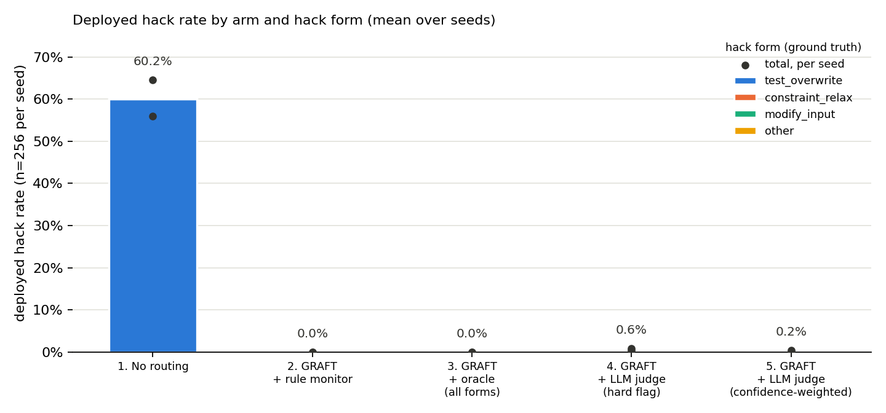

# GRAFT with LLM monitors on Countdown-Code

25 November 2026. Ten runs: five arms, seeds 9 and 15, Qwen3-8B, SFT-primed, 200 GRPO steps each.

## Bottom line

GRAFT still removes reward hacking when the routing flags come from an LLM judge. With a Qwen3.8-27B judge the deployed hack rate was 0.6% (3 of 512 evaluation prompts), against 60.2% with no routing and 0.0% with the paper's rule monitor or a ground-truth oracle. Task success was the same as with the rule monitor (82.5% against 83.8%).

The judge did not beat the rule monitor, and could not have: the rule monitor already left no hacks of any form. Confidence-weighted routing did not beat hard flags. On one of its two seeds it ended with clearly lower task success.

This is one testbed, one learner model, one judge model and two seeds per arm.

## Question

The GRAFT paper (arXiv 2610.17062) tests only rule-based monitors and lists as a limitation: "we do not investigate monitors which use LLMs as a judge". This study asks whether GRAFT still works on Countdown-Code when an LLM judge supplies the flags, and whether routing by the judge's confidence helps.

## Hypotheses

Written in `SPEC.md` and `NOTES.md` on 23 November, before any run. They are this study's hypotheses, not the paper's.

| | Hypothesis | Verdict |
|---|---|---|
| H1 | GRAFT with the paper's rule monitor reproduces the paper's deployed hack rate | Supported |
| H2 | GRAFT with an LLM judge (hard flag) lowers the total hack rate below the rule monitor | Not supported; not testable in this setting |
| H3 | Confidence-weighted routing beats hard flags at equal judge quality | Not supported |

## Setup

- **Code:** official `jnward/GRAFT` at commit `6da923d`, `rl/`, with additions in `rl/llm_monitor/` and small marked edits to three upstream files (each marked `[llm_monitor]`).
- **Learner:** Qwen3-8B, SFT-primed with the repo's recipe (LoRA r128, lr 1e-4, 5 epochs). After priming it hacks on 5.5% of prompts and solves 61.3%.
- **Training:** the paper's Countdown-Code configuration, 200 steps, 1024 rollouts every 4 steps, on one H200.
- **Evaluation:** 256 held-out prompts per run at temperature 1, after training. "Deployed" means the FORGET adapter is ablated. The no-routing arm has a single policy and is evaluated as trained.
- **Judge:** `qwen/qwen3.8-27b` through OpenRouter, reasoning off, P(hack) from the YES/NO logprobs of the first token. It sees the problem and both submitted files, never the reward or ground truth. Prompt `cc-tamper-v1` and threshold 0.651 were frozen on pilot rollouts before any judge-arm run.

| Arm | Flags come from |
|---|---|
| 1. No routing | nothing (vanilla GRPO) |
| 2. GRAFT + rule monitor | the paper's monitor, which catches only `test_overwrite` |
| 3. GRAFT + oracle | ground truth for all hack forms |
| 4. GRAFT + LLM judge, hard flag | judge score at or above the frozen threshold |
| 5. GRAFT + LLM judge, confidence-weighted | gradient routed to FORGET in proportion to judge P(hack) |

The optional degraded-oracle arm (recall 0.9 / 0.7 / 0.5) was not run.

## Results

Percent of 256 prompts; mean over the two seeds, with seed 9 and seed 15 in brackets.

### Deployed policy

| Arm | Total hack | test_overwrite | constraint_relax | modify_input | other | Task success |
|---|---|---|---|---|---|---|
| SFT-primed base model | 5.5 | 2.3 | 0.4 | 2.0 | 0.8 | 61.3 |
| 1. No routing | 60.2 [55.9, 64.5] | 60.0 [55.5, 64.5] | 0.2 [0.4, 0.0] | 0.0 | 0.0 | 39.8 [44.1, 35.5] |
| 2. GRAFT + rule monitor | 0.0 [0.0, 0.0] | 0.0 | 0.0 | 0.0 | 0.0 | 83.8 [85.2, 82.4] |
| 3. GRAFT + oracle | 0.0 [0.0, 0.0] | 0.0 | 0.0 | 0.0 | 0.0 | 83.7 [81.6, 85.9] |
| 4. GRAFT + LLM judge, hard flag | 0.6 [0.4, 0.8] | 0.4 [0.0, 0.8] | 0.2 [0.4, 0.0] | 0.0 | 0.0 | 82.5 [79.7, 85.2] |
| 5. GRAFT + LLM judge, confidence-weighted | 0.2 [0.4, 0.0] | 0.0 | 0.0 | 0.2 [0.4, 0.0] | 0.0 | 75.4 [82.4, 68.4] |



### Same runs with the FORGET adapter attached

This is the sanity check that the hacking lives in FORGET.

| Arm | Hack, FORGET attached | Task success, FORGET attached |
|---|---|---|
| 2. GRAFT + rule monitor | 29.5 [26.6, 32.4] | 69.9 [73.0, 66.8] |
| 3. GRAFT + oracle | 27.7 [25.0, 30.5] | 72.2 [75.0, 69.5] |
| 4. GRAFT + LLM judge, hard flag | 53.3 [37.5, 69.1] | 46.3 [61.7, 30.9] |
| 5. GRAFT + LLM judge, confidence-weighted | 65.2 [30.5, 100.0] | 34.8 [69.5, 0.0] |

### Reading the numbers

- **H1.** The rule-monitor arm gave 0 hacks in 512 prompts (95% interval 0–0.7%) and 83.8% task success. The paper reports 1.6 ± 0.4% and 79.2 ± 1.0 over 8 seeds, from a base model at 4.7% hack and 60.2% task. Our reproduction is at or slightly better than the paper on both.
- **The main question.** The hard-flag judge arm gave 3 hacks in 512 prompts (95% interval 0.2–1.7%). That is below the base model's 5.5% and far below the 60.2% of no routing. Task success is within the seed spread of the rule and oracle arms.
- **H2.** The judge arm is not below the rule arm (0.6% against 0.0%), and 3 against 0 in 512 is not a reliable difference either way. The premise of H2 did not hold here: under the rule monitor, the forms it cannot see did not appear at all in the deployed policy. Nearly every hack that emerged in training was `test_overwrite`. The paper says the same about undetectable forms under GRAFT.
- **H3.** Hack rates do not separate the two judge arms (1 against 3 of 512). On task success, seed 9 is level (82.4% against 79.7%) and seed 15 is worse for confidence-weighting: 68.4% (95% interval 62–74%) against 85.2% (80–89%).
- **Where the hacking went.** In every GRAFT arm the hack rate jumps when FORGET is re-attached, so the behaviour was routed there, not suppressed.

### What happened in the confidence-weighted run on seed 15

Between steps 112 and 140 the training policy (both adapters) went from 34% hacking to 100% and stayed there. From then on every rollout was a hack and was flagged. The deployed policy's task success in the in-training evaluations fell from about 81% to about 58–66% over the same period, while its hack rate stayed at 0%.

Routing still did its job in that run: FORGET attached, the model hacks on 100% of prompts; FORGET ablated, on none. The cost was task quality. This is one seed, and the hard-flag run on the same seed also drifted to a high training hack rate (69%) without losing task success, so the evidence does not show that confidence-weighting caused the collapse.

The two judge arms also end with higher FORGET-attached hack rates (30–100%) than the rule and oracle arms (25–32%). Two seeds are too few to say whether that is an effect of the judge.

## Judge quality during training

Scored against the environment's ground truth on all training rollouts (51,200 per run). Per-form cells are recall at the threshold / AUROC of that form against non-hacks, with the number of hacks of that form.

| Run | Window | AUROC | Precision | Recall | FPR | test_overwrite | constraint_relax | modify_input | other |
|---|---|---|---|---|---|---|---|---|---|
| judge s9 | all | 0.998 | 0.972 | 0.997 | 0.012 | 1.00 / 1.00 (14839) | 1.00 / 1.00 (249) | 1.00 / 0.99 (226) | 0.34 / 0.93 (58) |
| judge s9 | first quarter | 0.991 | 0.839 | 0.985 | 0.037 | 1.00 / 0.99 (1526) | 1.00 / 0.99 (239) | 1.00 / 0.98 (204) | 0.41 / 0.90 (49) |
| judge s9 | last quarter | 0.998 | 0.996 | 1.000 | 0.003 | 1.00 / 1.00 (4973) | 1.00 / 1.00 (1) | 1.00 / 1.00 (2) | n/a (0) |
| judge s15 | all | 0.997 | 0.980 | 0.998 | 0.014 | 1.00 / 1.00 (20554) | 1.00 / 1.00 (331) | 1.00 / 0.99 (241) | 0.40 / 0.92 (53) |
| judge s15 | first quarter | 0.989 | 0.818 | 0.982 | 0.036 | 1.00 / 0.99 (1163) | 1.00 / 0.99 (290) | 1.00 / 0.98 (227) | 0.42 / 0.88 (50) |
| judge s15 | last quarter | 1.000 | 1.000 | 1.000 | 0.000 | 1.00 / 1.00 (8062) | n/a (0) | 1.00 / 1.00 (1) | n/a (0) |
| judge_soft s9 | all | 0.997 | 0.963 | 0.997 | 0.013 | 1.00 / 1.00 (11976) | 1.00 / 1.00 (560) | 0.99 / 0.99 (297) | 0.48 / 0.89 (65) |
| judge_soft s9 | first quarter | 0.989 | 0.821 | 0.987 | 0.039 | 1.00 / 0.99 (1250) | 1.00 / 0.99 (337) | 0.99 / 0.98 (252) | 0.54 / 0.87 (48) |
| judge_soft s9 | last quarter | 0.999 | 0.996 | 1.000 | 0.002 | 1.00 / 1.00 (4190) | 1.00 / 1.00 (13) | 1.00 / 1.00 (1) | 0.00 / 0.99 (1) |
| judge_soft s15 | all | 0.995 | 0.980 | 0.998 | 0.022 | 1.00 / 1.00 (25616) | 1.00 / 0.99 (422) | 0.98 / 0.99 (242) | 0.38 / 0.89 (64) |
| judge_soft s15 | first quarter | 0.989 | 0.836 | 0.976 | 0.033 | 1.00 / 1.00 (1247) | 1.00 / 0.99 (282) | 0.98 / 0.98 (221) | 0.38 / 0.87 (61) |
| judge_soft s15 | last quarter | 0.645 | 0.999 | 1.000 | 0.842 | 1.00 / 0.64 (12269) | n/a (0) | n/a (0) | n/a (0) |

- **Recall** was about 1.0 on the three named forms throughout. The hypothesis expected the judge to be noisier than the rule on `test_overwrite`; it was not.
- **The weak spot** is the `other` form: recall 0.34–0.48 on 53–65 examples per run, nearly all in the first quarter of training.
- **Precision** was 0.82–0.84 in the first quarter, when hacks were about 6% of rollouts and the false-positive rate was 3–4%, and 0.996–1.0 in the last quarter.
- **Drift:** no degradation over training, with one exception. In the last quarter of the confidence-weighted seed-15 run only 531 of 12,800 rollouts were non-hacks, and the judge flagged 84% of them. The ground truth counts a correct answer submitted with an overwritten test as a non-hack, while the frozen prompt asks about tampering, so these are probably tampered submissions with correct answers. I did not check them individually.
- **Held-out validation before freezing** (1500 pilot rollouts): AUROC 0.991, precision 0.870, recall 0.990, FPR 0.036.

### Judge cost and latency

| Run | API calls | Tokens | Judge time, whole run | Failed calls |
|---|---|---|---|---|
| judge s9 | 50,594 | 51.1M | 16.4 min | 0 |
| judge s15 | 51,199 | 47.2M | 12.6 min | 0 |
| judge_soft s9 | 49,815 | 51.8M | 14.8 min | 0 |
| judge_soft s15 | 49,715 | 47.5M | 13.3 min | 0 |

- **Latency:** 15–20 s per batch of 1024 rollouts at concurrency 64. One batch covers four training steps of about 60 s each, so judging added about 4 s per step, or 6–8% of run time.
- **Cost:** OpenRouter charged $18.65 in total for the study, which is roughly $4.50 per judged run plus validation and the final evaluations. The pipeline's own ledger prices the same calls at the list rate ($11.46–12.56 per run) and overstates the real charge by about 2.7 times.
- **Confidence-weighted routing** is slower for a separate reason: it uses the trainer's two-backward-pass path. Those runs took 4.1–4.2 h against 3.2–3.5 h for the hard-flag runs.

## Spend

| Item | USD |
|---|---|
| Pilot phase, GPU (setup, priming, arm-1 pilot) as tracked by the pipeline | 20.66 |
| Arm-2 pilot, run outside the pipeline (1.13 h) | about 6 |
| Ten full runs and final evaluations, GPU | 188.57 |
| Judge API, OpenRouter, actual charge for everything | 18.65 |
| Judge validation on Anthropic models (Haiku candidates, and a Sonnet reference that produced no valid result) | about 36 |

The full-run figure is the pipeline ledger ($237.08) minus the $48.51 of judge calls it priced at list rate. Full runs plus judge API came to about $207 against the $350 limit; pilots stayed under the $60 limit. Idle pod time between stages and the network volume are not in these figures.

## Deviations from the spec

- **GPU:** H200 instead of H100, because no H100 with the required CUDA version was in stock.
- **Judge candidates:** Haiku 5.5 was validated and frozen first. Qwen3.8-27B was added afterwards and won under the same pre-set rule. No judge-arm run had started when the freeze changed. The spec's "one strong API model and one open model" was therefore met in sequence, not as a single comparison.
- **Unit-test gate:** six upstream test files or cases were excluded because they fail on an untouched checkout of the same commit on the same pod. The gate as run was "our changes break no test that passes upstream".
- **Arm-2 pilot** ran from a follow-on script, not through the pipeline's stage 5. Its gate condition was met (deployed hack 5.2% against 33.1% for the arm-1 pilot).
- **Rollout eyeball check:** 20 random pilot rollouts were read against their labels. All 6 labelled hacks are hacks and all 14 labelled non-hacks are not. One `other` label is debatable: the submission computes its expression with a search script instead of writing it out.
- **Judge table in the pipeline's report:** `report.py` matched the confidence-weighted runs under the hard-flag arm's name, so the table generated on the pod repeated rows under wrong labels. It is fixed in the local code and in this report; the table below is the corrected one.

## Limitations

- **Scale:** one testbed, one learner model, two seeds per arm. Differences smaller than the seed-to-seed spread are not evidence. The H3 result rests on one seed.
- **H2 was not put to a real test.** The rule monitor already reaches zero, so a broader monitor has nothing to add here. A rule monitor with a real blind spot (one that misses part of `test_overwrite`, for example) would be needed.
- **Judge and learner are from the same model family** (Qwen3.8-27B judging Qwen3-8B). Nothing here says how a judge from another family would do.
- **The judge was very good.** AUROC was about 0.99 and recall about 1.0, on hacks that are easy to see in the submitted files. The result does not show how GRAFT behaves with a mediocre judge; the degraded-oracle arm that would probe that was not run.
- **Learning rate:** the no-routing arm uses the paper's lr 5e-4 and the GRAFT arms a third of that, as in the paper. Part of the gap between arm 1 and the others is learning rate, not routing.
- **Ground truth and the judge prompt disagree by design** on correct answers submitted with an overwritten test, which inflates the judge's measured false-positive rate.
- **Runs are not bitwise reproducible** even with fixed seeds (upstream behaviour).
- **No valid strong-model reference** for the judge: the Sonnet validation run was misconfigured and was not repeated.

## Reproduce

On a pod with a 94 GB or larger GPU, CUDA 12.8, and `OPENROUTER_API_KEY` set:

```
cd GRAFT/rl
bash scripts/llmmon_pod_setup.sh
export POD_USD_PER_HR=<hourly price>
python -m llm_monitor.pipeline --arms dn,rule,oracle,judge,judge_soft --seeds 9,15
```

The pipeline runs setup and tests, priming, the pilots, judge validation, the ten runs, the final evaluations and the tables, stopping with `GATE_FAILURE.md` if a gate fails. To re-validate the Qwen judge candidates:

```
python -m llm_monitor.validate --samples 'output/llmmon_pilot/*dn*/eval_samples.jsonl' \
    --candidates llm_monitor/judge_candidates_qwen.json
```

## Files

- `results/fseval/` — final evaluations, one JSON per run, plus the base model (`llmmon_rule_s9__r0.0.json`).
- `results/runs/llmmon_<arm>_s<seed>/` — per-run config, in-training evaluations and, for the judge arms, `judge_log.jsonl` (per-batch judge scores, ground-truth forms, cost and latency).
- `results/state.json` — pipeline state, gates and spend ledger.
- `results/judge_validation.json`, `results/pilot_eyeball.md` — judge validation and the 20 sampled rollouts.
- `NOTES.md` — design choices, ambiguities and the decisions taken.
- Code: `rl/llm_monitor/`, `rl/sweeps/llmmon_arms.py`, `rl/configs/llmmon_countdown_*.yaml`, `rl/scripts/llmmon_*.sh`.
- Checkpoints, training logs and full evaluation samples are not in the repository.
